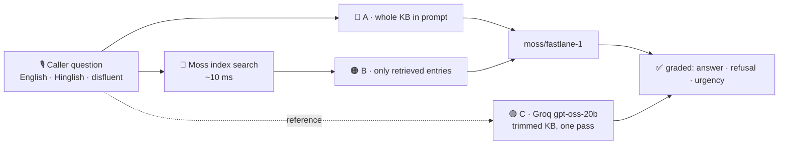
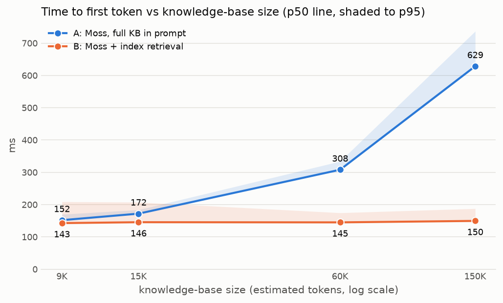

<div align="center">



<br>


**[⚡ TL;DR](#-tldr)** · **[🎯 Guess first](#-guess-before-you-click)** · **[📊 Results](#-results)** · **[🔍 The misses](#-case-file-d01-and-h03)** · **[🤖 Browser tasks](#-browser-tasks)** · **[🚨 Findings](#-findings)** · **[🧪 Reproduce](#-reproduce-it)**

</div>

---

## ⚡ TL;DR

[Resolvix](https://github.com/giri-harsh/Resolvix-AI) is a campus helpdesk **voice agent** that puts its whole knowledge base in the prompt.
I tested what changes if it retrieves from a [Moss](https://portal.usemoss.dev) index instead, and where the full prompt stops being a good idea.

<table>
<tr>
<td align="center" width="25%"><h2>4.2×</h2>sooner first token with retrieval at <b>150K</b> tokens</td>
<td align="center" width="25%"><h2>15.9 s</h2>first token on a cold <b>150K</b> full prompt <sub>(one observation)</sub></td>
<td align="center" width="25%"><h2>5.5×</h2>cheaper per turn with retrieval at <b>150K</b> <sub>(warm cache)</sub></td>
<td align="center" width="25%"><h2>13</h2>wrong retrieval answers, all from <b>2 questions</b></td>
</tr>
</table>

> [!IMPORTANT]
> **Retrieval is not a free win.** At 9K tokens, where Resolvix is today, the full prompt answered **120/120**, retrieval **117/120**, and the full prompt was also **cheaper**. Retrieval pays off as the knowledge base grows.



**The test:** 40 questions (11 English, 11 Hinglish, 8 disfluent, 6 unanswerable, 4 urgent), streamed, reply cache off.
The knowledge base grows from the Resolvix `data` branch (51 entries) to `data-scraped` (74) plus scraped college web pages.
Run on 26 November 2026 from one client location.

---

## 🎯 Guess before you click

<details>
<summary><b>1.</b> A task schema <i>requires</i> a hostel Wi-Fi password. The website has none. What does the browser agent return?</summary>
<br>

It wrote **"Not found on the website pages searched"** into the required `wifi_password` string, and the schema check **passed**. Code that trusts `verification.passed` would treat that sentence as a password.
</details>

<details>
<summary><b>2.</b> You cap a task at <code>$0.01</code>. What do you pay?</summary>
<br>

**$0.024.** The task failed with `budget_exceeded`, 2.4× over the cap. The docs say the cap covers model calls only and lets running calls finish.
</details>

<details>
<summary><b>3.</b> 99.9% of a 150K-token prompt is cached. Does the first token get fast?</summary>
<br>

**No.** It still took **629 ms** at p50, against 152 ms at 9K.
</details>

<details>
<summary><b>4.</b> The voice agent starts getting tokens at ~145 ms. When can it start <i>speaking</i>?</summary>
<br>

At about **590 ms**. Resolvix's reply format puts a JSON header before the sentence, so roughly 450 ms goes by first. Moving the header to the end should remove most of that wait (not tested).
</details>

---

## 📊 Results



| KB tokens | 🔵 A: first token | 🟠 B: first token | 🔵 A: correct | 🟠 B: correct | 🔵 A: $/1k turns | 🟠 B: $/1k turns |
|:--|--:|--:|:-:|:-:|--:|--:|
| **9K** | 152 ms | **143 ms** | **120/120** | 117/120 | **0.63** | 0.92 |
| **15K** | 172 ms | **146 ms** | **120/120** | 117/120 | **0.85** | 0.96 |
| **60K** | 308 ms | **145 ms** | **120/120** | 117/120 | 2.26 | **0.92** |
| **150K** | 629 ms | **150 ms** | **80/80** | 76/80 | 5.03 | **0.91** |

Latencies are p50. Server-side retrieval took 9.8–10.5 ms p50 (14–19 ms p95) at every size; the network round trip to Moss was 38 ms median.

<details>
<summary><b>📋 Full table:</b> p95, speakable-word latency, tokens and the Groq reference</summary>
<br>

| KB tokens | Arm | Calls | TTFT p50 / p95 ms | First speakable word p50 / p95 ms | Total p50 ms | Correct | Prompt tokens | $ per 1k turns |
|---|---|---|---|---|---|---|---|---|
| 9K | A | 120 | 152 / 170 | 600 / 650 | 779 | 120/120 | 10,243 | 0.63 |
| 9K | B | 120 | 143 / 209 | 588 / 655 | 769 | 117/120 | 2,889 | 0.92 |
| 9K | C | 31 | 677 / 906 | 814 / 1011 | 817 | 29/31 | 7,601 | 0.53 |
| 15K | A | 120 | 172 / 184 | 624 / 696 | 815 | 120/120 | 17,437 | 0.85 |
| 15K | B | 120 | 146 / 208 | 591 / 662 | 798 | 117/120 | 3,031 | 0.96 |
| 60K | A | 120 | 308 / 334 | 775 / 836 | 993 | 120/120 | 66,002 | 2.26 |
| 60K | B | 120 | 145 / 175 | 592 / 640 | 771 | 117/120 | 3,047 | 0.92 |
| 150K | A | 80 | 629 / 737 | 1134 / 1247 | 1361 | 80/80 | 160,145 | 5.03 |
| 150K | B | 80 | 150 / 188 | 595 / 647 | 771 | 76/80 | 3,039 | 0.91 |

**A** = `moss/fastlane-1` with the whole KB. **B** = same model and persona with Moss retrieval (`X-Moss-Indexes`).
**C** = Groq `gpt-oss-20b`, prompt trimmed of question variants, one pass. C is a reference, not a like-for-like arm.
</details>

<details>
<summary><b>🎯 Retrieval hit rate</b> (local <code>MossClient.query</code>, rank of the expected entry)</summary>
<br>

| KB | hit@1 | hit@3 | hit@5 |
|---|---|---|---|
| 9K | 25/34 | 32/34 | 33/34 |
| 15K | 30/39 | 36/39 | 38/39 |
| 60K | 30/39 | 36/39 | 38/39 |
| 150K | 29/39 | 37/39 | 39/39 |
</details>

---

## 🔍 Case file: D01 and H03

All **13** wrong answers in B come from these two questions. Each time the agent escalated although the answer was in the index.

| Case | Question |
|---|---|
| **D01** (disfluent) | *"uh so um I wanted to ask… no wait, sorry, not that, how do I um pay the fees online?"* |
| **H03** (Hinglish) | *"college ka address kya hai?"* |

<details>
<summary><b>🧾 Open the evidence:</b> chunks and scores</summary>
<br>

Top 5 from `MossClient.query`, in returned order. **Expected entry in bold.** Full list: [results/d01_h03_chunks.csv](results/d01_h03_chunks.csv).

| Case | KB | B wrong | Local top 5 (id score) |
|---|---|---|---|
| H03 | 9K | ❌ 3/3 | GEN-102 .621, FEE-102 .632, TRN-101 .574, GEN-106 .547, **GEN-104 .517** |
| H03 | 15K, 60K | ✅ 0/6 | **GEN-104 .575**, ADM-109 .569, EXM-101 .651, GEN-119 .610, TRN-102 .610 |
| H03 | 150K | ❌ 2/2 | **GEN-104 .575**, ADM-109 .569, WEB-0238 .683, EXM-101 .651, GEN-119 .610 |
| D01 | 9K | ✅ 0/3 | **FEE-101 .412**, FEE-108 .332, FEE-107 .258, TRN-102 .204, FEE-102 .225 |
| D01 | 15K, 60K | ❌ 6/6 | FEE-111 .401, FEE-102 .350, FEE-113 .243, **FEE-103 .214**, EXM-104 .148 |
| D01 | 150K | ❌ 2/2 | FEE-111 .401, FEE-102 .350, FEE-113 .243, WEB-0355 .222, **FEE-103 .214** |
</details>

**Verdict:** D01 failed whenever the expected entry ranked 4th or 5th and passed when it ranked 1st. H03 does **not** fully fit: at 150K it ranked 1st locally and still failed twice. The inference API does not return the chunks it used, so the server's ranking cannot be checked.

---

## 🤖 Browser tasks

Four runs on akgec.ac.in with `moss-balanced`, 180 s cap.

| | Task | Outcome | Cost / cap | Time, steps |
|:-:|---|---|---|---|
| ✅ | B.Tech first-year fee, JSON schema | **Correct:** Rs 142156 with the right URL, read from an embedded PDF | $0.096 / $0.20 | 52 s, 7 |
| ✅ | Impossible: stock ticker and share price | Returned nulls, invented nothing. Status `completed`, schema failed. Went to an outside search engine | $0.111 / $0.20 | 121 s, 9 |
| ❌ | Required field with no data: Wi-Fi password | Placeholder sentence, **schema passed** | $0.196 / $0.20 | 113 s, 17 |
| ⚠️ | $0.01 spend cap | `budget_exceeded`, but **$0.024** spent | $0.024 / $0.01 | 8 s, 1 |

Browser traffic cost was still unreported (`traffic_usd: null`) after the run.

---

## 🚨 Findings

| | Finding |
|:-:|---|
| 🔴 | Full-prompt first-token time grows with KB size (152 ms → 629 ms). Retrieval stays near 145 ms. |
| 🔴 | **Cold starts** (one observation each): a new, mostly uncached full prompt reached first token after 1.3 s (15K), 4.3 s (60K), 15.9 s (150K). The first search on a new index took 2.2–2.5 s. Both can exceed Resolvix's 3 s first-token timeout. |
| 🔴 | A `required` schema field can be satisfied by a placeholder sentence, with `verification.passed: true`. |
| 🔴 | *Resolvix side:* this Groq on-demand key rejects the unmodified 51-entry prompt (HTTP 413, 8,000 tokens per minute); `gpt-oss-120b` returned empty replies on a trimmed prompt (3 logged calls). C stopped at the 200,000-token daily quota. |
| 🟠 | Retrieval lost 3 of 120 answers up to 60K, and 4 of 80 at 150K, that the full prompt got right. |
| 🟠 | Pre-model retrieval returns only `X-Moss-Retrieve-Ms`: no chunk ids or scores. `MossClient.query` runs a local embedding model and is not guaranteed to match. |
| 🟠 | `max_cost_usd` overshot at $0.01. |
| 🟠 | Below about 15K tokens the full prompt is cheaper ($0.50 per 1k searches, plus less prefix caching). By 60K retrieval is about 2.5× cheaper. |
| 🟡 | An impossible task ends `completed`; callers must check `verification.passed`. |
| 🟢 | Grounded first token is under 200 ms at p50, as documented; p95 was 175–209 ms. |
| 🟢 | Urgent-call detection: A and B 100%. C missed 2 of 4. |
| ℹ️ | About 450 ms passes between first token and first speakable word, because of the JSON-header reply format. |
| ℹ️ | The Resolvix `data` prompt is about 9K tokens, not the ~100K originally assumed. |

🔴 high · 🟠 medium · 🟡 low · 🟢 works well · ℹ️ context

---

## 🧂 Read the numbers with care

<details>
<summary><b>Limits of this evaluation</b></summary>

- One machine, one afternoon. A and B calls were interleaved. The tasks ran during the second 150K pass (its p50 matched the first).
- Cost columns assume the warm prefix cache of a back-to-back benchmark. Real call traffic will cache less.
- Costs are computed from token counts at published prices.
- C is not like for like: smaller model, trimmed prompt, 31 calls; rate-limit waits are excluded from its latency.
- Grading is rule-based ([core/grade.py](core/grade.py)). 6 arm-A replies that stated the right fact in other words were corrected by hand ([core/overrides.csv](core/overrides.csv)). Task correctness was checked by hand.
- Questions and expected answers were written from the knowledge base, so they favour answerable, single-entry lookups.
</details>

<details>
<summary><b>What was not run</b></summary>

- The 432K level (larger than the 262,144-token window) and the third 150K pass: stopped for time.
- 9 of 40 questions for C (daily quota).
- Hinglish query rewrite and speculative (prefix) retrieval: scripts are in `combos/`, **not run**.
- **Jev gate: planned, not run** (no key). Design: after retrieval, send the query, Moss top-k chunks and scores to a Jev Choice question with options `answer` / `refuse` / `escalate` / `urgent_transfer`; report refusal accuracy, escalation precision and recall, and added latency against arm B.
- Other Tasks cases (cancel, 1-minute cap, fake task id, malformed schema, a goal asking to ignore limits, more lookups), concurrency sweeps, OpenAI-SDK compatibility and the error-case matrix.
</details>

---

## 🧪 Reproduce it

Python 3.12. Set `MOSS_PROJECT_ID`, `MOSS_PROJECT_KEY` and (for arm C) `GROQ_API_KEY` in the environment, or in a dotenv file named by `EVAL_ENV_FILE`.
Knowledge-base files come from a clone of Resolvix-AI at pinned commits (cloned automatically, or set `RESOLVIX_REPO`).

```bash
pip install -r requirements.txt
python common.py && python -m core.grade && python -m core.make_eval_set   # offline checks
python -m core.network
python -m core.build_index 0
python -m core.run_core --level 0 --arms moss_full,moss_rag --reps 3
python -m core.build_index 2 && python -m core.run_core --level 2 --arms moss_full,moss_rag && python -m core.build_index 2 --delete
python -m core.run_core --level 0 --arms groq --reps 1 --groq-model openai/gpt-oss-20b --compact-prefix
python -m tasks.run_tasks lookup_fee impossible missing_required limit_cost
python analyze.py
```

> [!TIP]
> A spend guard stops any call that could pass **$8.00** in total ($3 / $3 / $2 for core, tasks and combos).

<details>
<summary><b>🗂️ Repo map</b></summary>

| Path | What is inside |
|---|---|
| [`common.py`](common.py) | Credentials, redacted JSONL logging, spend guard, timed streaming calls |
| [`core/`](core) | Knowledge-base levels, index builder, 40-question eval set, runner, grader |
| [`tasks/`](tasks) | Browser-task cases and hand checks |
| [`combos/`](combos) | Rewrite and speculative retrieval (not run), server-context probe |
| [`analyze.py`](analyze.py) | Logs → CSVs, chart and tables |
| [`results/`](results) | CSV tables and the chart |
| [`logs/`](logs) | Requests, responses and timings; keys, account ids, phone numbers and e-mail addresses redacted |

In `results/spend_log.csv` per-test amounts overlap where tests ran at the same time; `logs/spend_ledger.jsonl` is authoritative.
</details>

---

<div align="center">

**Spend:** $2.06 on the Moss portal for the day, about $1.99 for this work after an earlier $0.07 manual task (script estimate $1.91). Groq about $0.02.

<sub>Built by <a href="https://github.com/giri-harsh">giri-harsh</a>, who builds real-time voice agents.</sub>

<a href="#-tldr">⬆️ Back to top</a>

</div>
